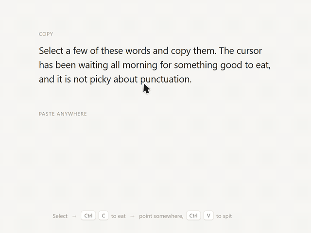

# Hungry Cursor

A small interaction prototype: copy and paste, made physical.

When you copy, the selected words slide off the page and curve into the cursor tip, which chews and swallows them. When you paste, the tip opens and the words come back out, arc over and land to the right of the pointer.

## Try it

Open `index.html` in a desktop browser. No build step or dependencies.

1. Select some words in the paragraph.
2. Press `Ctrl C` (`⌘ C` on Mac).
3. Point anywhere on the page and press `Ctrl V` (`⌘ V`).

Add `?slow=5` to the URL to play the motion at a fifth of the speed.

## How it works

- The cursor is a custom SVG arrow drawn in two halves, so the tip can open and close. Its position follows the mouse directly; the squash, tilt, swallow and jaw are springs.
- Copied text is measured character by character from the real selection, then each line is moved along a path into the tip as one ribbon, narrowing as it reaches the mouth.
- Paste places the text at the pointer, lays it out invisibly to find where each line lands, then runs the same ribbon in reverse.
- The original words fade while being swallowed using the CSS Custom Highlight API, so the page text is never modified.
- With `prefers-reduced-motion`, nothing flies: copied text stays put and pasted text fades in.

The custom cursor only appears on devices with a mouse.
